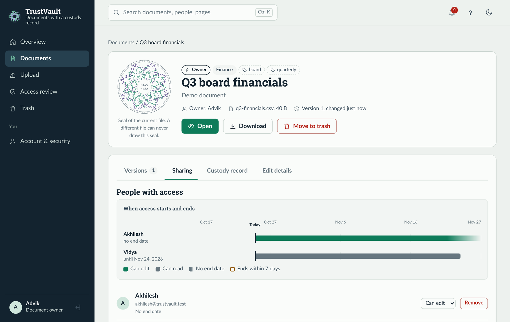
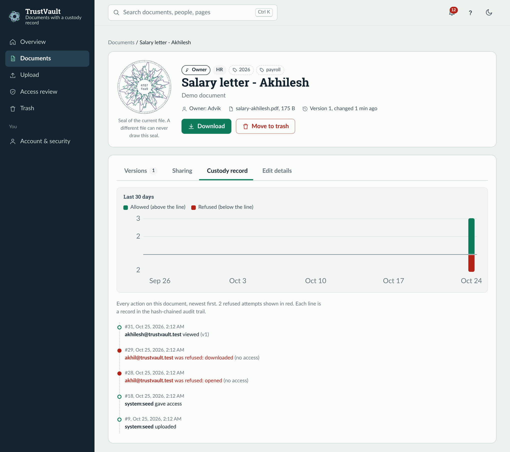
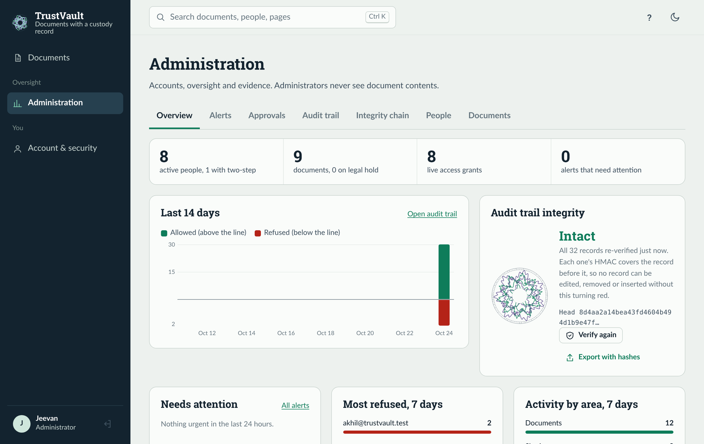
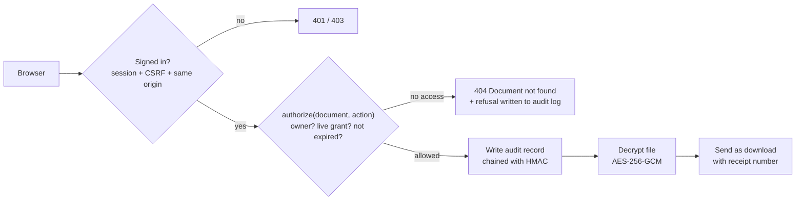

# 🔐 TrustVault

### Share confidential documents with exactly the right people, and prove it afterwards.

**🌐 [Live demo](https://trustvault-15td.onrender.com)** &nbsp;·&nbsp;
**🎬 [Demo video](https://drive.google.com/file/d/19AhF_S_3fs8nve1jqsag5aiMCbpd3T-V/view?usp=drive_link)** &nbsp;·&nbsp;
**📝 [Write-up](WRITEUP.md)** &nbsp;·&nbsp;
**🛡️ [Threat model](THREATS.md)** &nbsp;·&nbsp;
**🤖 [AI log](PROMPTS.md)** &nbsp;·&nbsp;
**🔌 [API](API.md)** &nbsp;·&nbsp;
**🚀 [Deploy guide](DEPLOY.md)**

> ⏳ **First visit slow?** The demo runs on Render's free plan. It sleeps after 15 minutes without visitors, so the first page can take about a minute to load. It also resets to fresh demo data when it wakes.

---

## 💡 The idea in 30 seconds

Companies pass around salary letters, contracts and board papers every day, and usually nobody can say for sure **who can open a file right now**, **who actually opened it**, or **whether the person they removed is really locked out**.

TrustVault makes three promises and keeps them:

| | Promise | How |
|---|---|---|
| 🔒 | **Only the people you name can open a document** | One function, `authorize()`, checks every request against the database. Everyone else gets *"Document not found"*, as if it doesn't exist. |
| 🧾 | **Every access can be proved, even the refused ones** | Every view, download, change and refusal goes into an audit log where each record is cryptographically chained to the one before. Change one record and the chain breaks. |
| ⚡ | **Taking access away works instantly** | Nothing is cached. Remove someone and their very next click is refused, even on a page they already have open. |

And one rule that makes it trustworthy: **even administrators cannot read your documents.** They manage accounts and the audit trail, never the content.

---

## 🧭 Try it in 2 minutes

Open the **[live demo](https://trustvault-15td.onrender.com)**. The sign-in page has a **"Demo accounts for reviewers"** list, so you can sign in with one click.

1. **Sign in as Advik** (owner) and open **Salary letter - Akhilesh**. Copy the address from the browser bar.
2. **Open a private window, sign in as Akhil** (viewer) and paste that address. You get **"Document not found"**: he was never given it.
3. **Back as Advik**, open the document's **Custody record** tab. Akhil's attempt is there in red, with the time. (The admin's audit trail also shows his IP address.)
4. **Share and take back:** as Advik, upload any `.md` or `.txt` file, share it with Akhil for 7 days, let Akhil open it, then click **Remove**. Akhil's next click is refused.
5. **Sign in as Jeevan** (admin) → **Administration**. The audit trail shows **"Intact"**. Try **Documents**: the admin sees titles and owners, never the contents.

---

## 👥 Demo accounts

| Who | Email | Password | What to try |
|---|---|---|---|
| 🛠️ **Jeevan**, administrator | `jeevan@trustvault.test` | `Admin_123_demo` | Audit trail, integrity check, alerts, users. You **cannot** open anyone's documents. |
| 🛠️ **Arjun**, second administrator | `admin2@trustvault.test` | `Arjun-Demo-2026!` | Approves what the first admin requests (Administration → Approvals). |
| 📁 **Advik**, owner | `advik@trustvault.test` | `Owner1_123_demo` | Owns the salary letters, Q3 financials and partner contract. Share, revoke, read the custody record. |
| 📁 **Vidya**, owner | `vidya@trustvault.test` | `Owner2_123_demo` | Owns the engineering and audit papers, plus private notes nobody else can read. |
| 👀 **Akhilesh**, viewer | `akhilesh@trustvault.test` | `Viewer1_123_demo` | Reads his salary letter and the audit papers, and can edit the Q3 financials. |
| 👀 **Akhil**, viewer | `akhil@trustvault.test` | `Viewer2_123_demo` | Reads his salary letter and the site photo, and can edit the bridge drawings. Nothing else. |
| 🌍 **Pat**, external partner | `ext@partner.test` | `Partner-Demo-2026!` | Sees only the partner contract. |
| 🔑 **Maya**, owner with two-step sign-in | `maya@trustvault.test` | `Maya-Demo-2026!` + a code | Add the setup key `JBSWY3DPEHPK3PXPTRUSTVAULTDEMO22` to any authenticator app ("Enter a setup key", time-based), or run `oathtool --totp -b JBSWY3DPEHPK3PXPTRUSTVAULTDEMO22`. The key is public on purpose, for the demo only. |

<details>
<summary><b>Demo-mode rules (so reviewers can't lock each other out)</b></summary>

While `TV_DEMO_MODE=1`, nobody can change the password or sign-in settings of these shared accounts, **including the admin**. Deactivating a user and changing a role are still allowed so you can test revocation; please undo them afterwards. To try password reset, two-step enrolment or offboarding, create your own account under **Administration → People**. To restore the demo data locally, run `python -m scripts.seed --reset`.
</details>

---

## 📸 A look inside

**Sharing: who can open a document, and until when.** Advik shares the Q3 financials with Akhilesh (edit, no end date) and Vidya (read, until 24 November). The timeline shows exactly when each person's access starts and ends.



**Custody record: every action, including refusals.** Akhil was never given Akhilesh's salary letter. Both of his attempts, to open it and to download it, are recorded in red, next to Akhilesh's legitimate view.



**Administration: oversight without access.** The admin sees allowed versus refused activity, the most-refused people, and the audit trail verified as **Intact**, but never the contents of any document.



---

## ⚙️ How it works

Every request to a document passes through the same checkpoints:



**The audit chain**, in one line:

```
hash = HMAC-SHA256(audit_key, previous_hash + this_record)
```

Each record's hash depends on every record before it, and the key lives only on the server, never in the database. Edit, delete or insert a record and the chain breaks at that exact point. Database triggers also block any update or delete on the audit table.

---

## 🧑‍🤝‍🧑 Who can do what

| | 🛠️ Admin | 📁 Owner | 👀 Viewer |
|---|:---:|:---:|:---:|
| Upload new documents | ❌ | ✅ | ❌ |
| Open or download a document | only if shared with them | their own, or if shared | only if shared with them |
| Edit or upload a new version | only with edit access | their own, or with edit access | only with edit access |
| Share, extend or restore access | ❌ | their own documents | ❌ |
| Revoke access, delete, see the custody record | ❌ | their own documents | ❌ |
| Access review with bulk revoke | ❌ | ✅ | ❌ |
| Two-step sign-in, manage own sessions | ✅ | ✅ | ✅ |
| Manage accounts, full audit trail, alerts | ✅ | ❌ | ❌ |
| See document titles and owners (never contents) | ✅ | ❌ | ❌ |
| Transfer ownership, offboard a leaver, legal hold | ✅ *(risky actions need a second admin)* | ❌ | ❌ |

**Role never grants access to a document.** It can only take the power to share away: an owner who is demoted to viewer can still revoke and delete their documents, but can no longer hand them to anyone. Admins and viewers can't upload new documents on purpose (least privilege). The full reasoning is in [WRITEUP.md](WRITEUP.md).

---

## 🛡️ Security at a glance

| Area | What TrustVault does |
|---|---|
| **Access** | One `authorize()` decision on every document route; strangers get 404 so IDs can't be probed; no permission is ever cached |
| **Race conditions** | Checks run inside a locked transaction, so a revoke can't slip between "allowed" and "file sent" |
| **Audit** | HMAC hash chain, update and delete blocked by triggers, refusals always recorded, witness copy of each record in the server logs |
| **Files at rest** | AES-256-GCM, a fresh key per file, wrapped by a master key that lives only in the environment |
| **Uploads** | Allow-listed types, real file contents checked, no macros or PDF scripts, 10 MB limit, always downloaded as attachments |
| **Sign-in** | scrypt passwords, lockout after 5 wrong tries, optional two-step codes with replay protection |
| **Sessions** | `__Host-` cookies, HttpOnly, SameSite=Strict, CSRF token and Origin check, 30-minute idle timeout |
| **Sensitive actions** | Re-enter your password before sharing; a second admin must approve password resets, transfers and new admins |
| **Browser** | Strict Content-Security-Policy, no inline scripts, text-only rendering, clickjacking blocked, HSTS |

About 135 threats, each with its control, status and the test that proves it, are in **[THREATS.md](THREATS.md)**.

---

## 🧪 Proof, not promises

The brief said reviewers would delete an authorisation check and run the tests, so the tests were built for exactly that.

| Check | Result | Command |
|---|---|---|
| Test suite | ✅ **187 tests pass** | `python -m unittest discover -s tests -t .` |
| Named mutants: remove 67 specific security checks one at a time | ✅ **67 / 67 caught** | `python -m scripts.mutation_check` |
| Mutation sweep: automatically delete *every* `authorize()` call and access decorator | ✅ **85 / 85 caught** | `python -m scripts.mutation_sweep` |
| Live attack: 48 attacks against the deployed site from outside | ✅ **48 / 48 pass** | `python -m scripts.check_live https://trustvault-15td.onrender.com` |
| Audit chain verification | ✅ **Intact** | `python -m scripts.verify_audit` |

> 💡 **Try it yourself:** delete the line `authorize(doc_id, "download")` in `app/routes/documents.py` and run the tests. About 18 fail. Put it back and they pass.

---

## ✨ Features

<details open>
<summary><b>For owners and viewers</b></summary>

- 📤 **Multi-file upload** (up to 20 at once) with drag and drop, checks before sending, and progress bars
- 🔎 **Search** by title, owner, category, tag and date
- 🤝 **Sharing by name** with read or edit access and an end date, shown on a **timeline** of when each person's access starts and ends
- 👁️ **Safe in-app viewer** for text, Markdown, CSV and images; each view gets an audit **receipt number**. PDFs and Office files always download, so they can never run code on the site.
- 🗂️ **Versions**: new uploads keep the old ones; readers only see the current version
- 🧾 **Custody record** per document, with a 30-day activity chart and refusals in red
- 🗺️ **Access review**: every grant on your documents as a table or a people × documents map, with bulk revoke
- 🔔 **Activity feed** with a live unread badge: who opened, downloaded or was refused on your documents
- 🗑️ **Trash** with 30 days to restore
- 🌀 **Custody seals**: every file version gets a unique rosette drawn from its SHA-256, like security printing on a banknote; one changed byte draws a different seal
</details>

<details>
<summary><b>For administrators</b></summary>

- 📊 Overview with a 14-day chart of allowed versus refused events
- ✅ Live **audit integrity** check with *Verify again*, and an **integrity chain explorer**
- 🚨 Alerts for repeated refusals, privileged actions, and admins without two-step sign-in
- 👤 Users: create, deactivate, change role, unlock, offboard a leaver in one step
- 🤝 **Approvals** tab for the two-person rule
- ⚖️ Legal hold, which stops deletion and grants no access
</details>

<details>
<summary><b>Everyday comfort</b></summary>

- ⌨️ Command palette (**Ctrl/⌘ K** or **/**) and keyboard shortcuts (**?** lists them)
- 🌗 Light and dark themes, fully responsive, keyboard and screen-reader friendly
- 🧱 No inline scripts or styles, and fonts (Roboto Slab, Lato) bundled locally, so the strict security policy stays intact
</details>

---

## 💻 Run it on your machine

You need **Python 3.11+** and **Git**.

**Windows**
```bash
git clone https://github.com/PailaJeevan/trustvault.git
cd trustvault
py -m venv .venv
.venv\Scripts\activate
pip install -r requirements.txt
python -m scripts.seed
python wsgi.py
```

**macOS / Linux**
```bash
git clone https://github.com/PailaJeevan/trustvault.git
cd trustvault
python3 -m venv .venv
source .venv/bin/activate
pip install -r requirements.txt
python -m scripts.seed
python wsgi.py
```

Then open **http://127.0.0.1:5000** and sign in as `advik@trustvault.test` / `Owner1_123_demo`.

In development the app creates its own keys in `instance/dev_keys.json`. In production (`TV_ENV=production`) it refuses to start unless `TV_MASTER_KEY` and `TV_AUDIT_KEY` are set, and refuses if they are the same.

---

## 🗂️ Project map

```
trustvault/
├── app/
│   ├── authz.py          ← the authorisation decision: authorize(document, action)
│   ├── audit.py          ← HMAC-chained audit log and chain verification
│   ├── auth.py           ← sessions, cookies, CSRF, role decorators, step-up
│   ├── security.py       ← passwords, AES-256-GCM encryption, fingerprints
│   ├── uploads.py        ← upload validation (types, real contents, macros)
│   ├── totp.py           ← two-step sign-in codes
│   ├── routes/           ← API: documents, grants, admin, auth, review, insights, users
│   ├── schema.sql        ← database schema
│   ├── migrations.py     ← in-place database upgrades
│   └── static/           ← the web interface (plain JavaScript, no framework)
├── scripts/              ← seed, check_live, mutation_check, mutation_sweep, verify_audit, purge, rotate_master_key
├── tests/                ← 187 tests
├── Dockerfile · render.yaml · docker-entrypoint.sh   ← deployment
└── THREATS.md · WRITEUP.md · PROMPTS.md · API.md · DEPLOY.md
```

---

## 🚀 Deployment

The live demo runs on **Render** at **https://trustvault-15td.onrender.com**. It is built from the `Dockerfile` by the Blueprint in `render.yaml`, Render generates both secret keys, and every push to `main` redeploys it. Full steps, every setting and a troubleshooting table are in **[DEPLOY.md](DEPLOY.md)**.

On the free plan the data, including the audit trail, resets when the server sleeps. That's an honest limit, recorded in THREATS.md (OP-17); a paid plan with a disk keeps everything.

**Database and backups:** the schema is in [`app/schema.sql`](app/schema.sql) and upgrades are in [`app/migrations.py`](app/migrations.py); both apply automatically on start. To back up, run `sqlite3 "$TV_DATABASE_PATH" ".backup backup.db"`, and store the backup and `TV_MASTER_KEY` separately, since neither is useful without the other.

**Check the audit trail:** in the app, open **Administration → Overview → Audit trail integrity**; from a console, run `python -m scripts.verify_audit`, or `python -m scripts.verify_audit --against export.jsonl` to compare with an earlier export.

---

## 🤖 Built with AI, checked by tests

TrustVault was built with **Claude** (Anthropic), which I directed, ran, tested and deployed. Every security claim was treated as wrong until a test proved it. **[PROMPTS.md](PROMPTS.md)** records 20 dated cases where the AI was wrong and how each was caught. Highlights:

- refused attempts were being rolled back out of the audit log along with the failed transaction;
- at one point **41 of 69** authorisation checks could be deleted without any test failing, which led to the mutation sweep;
- on Render, the audit trail recorded Render's internal address instead of the visitor's IP, found by running the live checker.

---

## 🚧 Honest limits

- Two administrators acting together can still take over an account (one alone cannot).
- Deleting the *newest* audit records is detected only by comparing with an export or the server logs.
- Two-step sign-in is optional, not required for admins.
- No virus scanning, and the PDF safety check is pattern-based.
- No email: no password reset by email and no notifications.
- On Render's free plan, data resets when the server sleeps.

---

## 📦 Hand-in map

| Required | Where |
|---|---|
| Live demo with seed data | **https://trustvault-15td.onrender.com** (accounts above) |
| Threat model | [THREATS.md](THREATS.md) |
| AI usage log | [PROMPTS.md](PROMPTS.md) |
| Tests | [`tests/`](tests), [`scripts/mutation_check.py`](scripts/mutation_check.py), [`scripts/mutation_sweep.py`](scripts/mutation_sweep.py), [`scripts/check_live.py`](scripts/check_live.py) |
| Schema and setup | [`app/schema.sql`](app/schema.sql), [`scripts/seed.py`](scripts/seed.py), [Run it on your machine](#-run-it-on-your-machine) |
| API documentation | [API.md](API.md) |
| Write-up | [WRITEUP.md](WRITEUP.md) |
| Demo video | [TrustVault-Demo.mp4](https://drive.google.com/file/d/19AhF_S_3fs8nve1jqsag5aiMCbpd3T-V/view?usp=drive_link) |
